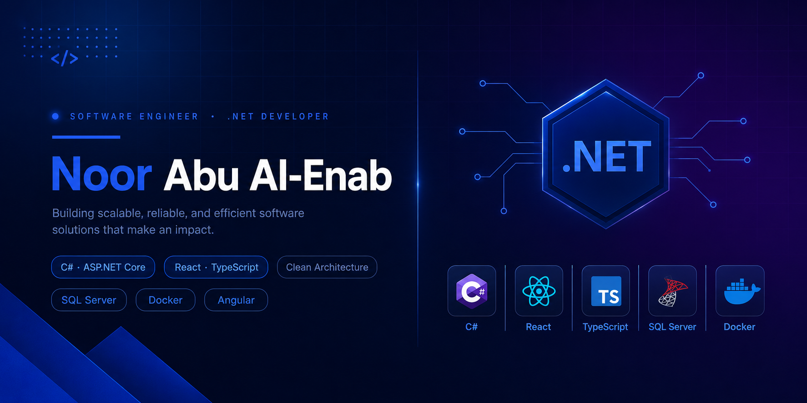

 

<h1 align="left">Hi, I'm Noor Abu Al-Enab 👋</h1>

  <b>Software Engineer · Full-Stack .NET</b>: building scalable, production-ready web applications, from event-driven backend services to React and Angular frontends. 
  4+ years of professional experience · C# · ASP.NET Core · Clean Architecture · DDD · CQRS · Open to remote & freelance

---

<h2 align="left">🚀 Notable Work</h2>

### 🚛 FMS Tech: Fleet Telematics Platform *(4+ years)*
Modernizing a large legacy ASP.NET MVC platform into .NET 8 services, with live tracking, video telematics, road-safety analytics and high-volume reporting.

- Improved performance of high-volume reports and backend services by **up to 70%**: connection reuse, removing duplicate API calls, O(n²) → dictionary lookups, indexed temp tables and pre-aggregated data
- Built the core of an **event-driven** on-demand delivery order module: DDD aggregates, domain events dispatched via **MediatR**, real-time **SignalR** notifications
- Led the migration of a legacy video-telematics module into a **.NET 8** service of 25 vertical slices (**CQRS**, FluentValidation, Carter minimal APIs)
- Led the migration of production reports from **RDLC to DevExpress**
- Vertical-slice CQRS features with **Redis** caching, covered by unit tests (**TUnit, Moq**) and **BenchmarkDotNet** benchmarks

`C#` `.NET 8` `ASP.NET Core` `CQRS / MediatR` `DDD` `Redis` `SignalR` `SQL Server` `DevExpress` `Angular`

---

### 🛒 Matensa Voucher Platform *(freelance, 2026)*
End-to-end digital voucher & gift card e-commerce platform, built solo from architecture to production.

- Multi-provider fulfillment engine with **circuit-breaker, retry & timeout** resilience strategies
- Dual-wallet system with multi-currency support and **AES-encrypted** voucher code storage
- Multi-layer auth: **OTP · JWT · API key · RBAC** with full entity-level audit logging
- React + TypeScript storefront, admin dashboard, Docker deployment, Azure Key Vault

`C#` `ASP.NET Core` `Clean Architecture` `EF Core` `PostgreSQL` `React` `TypeScript` `Docker` `Azure Key Vault`

---

<h2 align="left">🔧 Tech Stack</h2>

<h4 align="left">Backend</h4>

  
  
  
  
  
  
  
  
  

<h4 align="left">Messaging & Caching</h4>

  
  
  

<h4 align="left">Frontend</h4>

  
  
  
  
  
  
  

<h4 align="left">DevOps & Tools</h4>

  
  
  
  
  
  
  

---

<h2 align="left">📫 Let's Connect</h2>

  
  

 

> 💼 **Open to remote positions and freelance projects**: full-stack or backend .NET, in Europe and worldwide.
